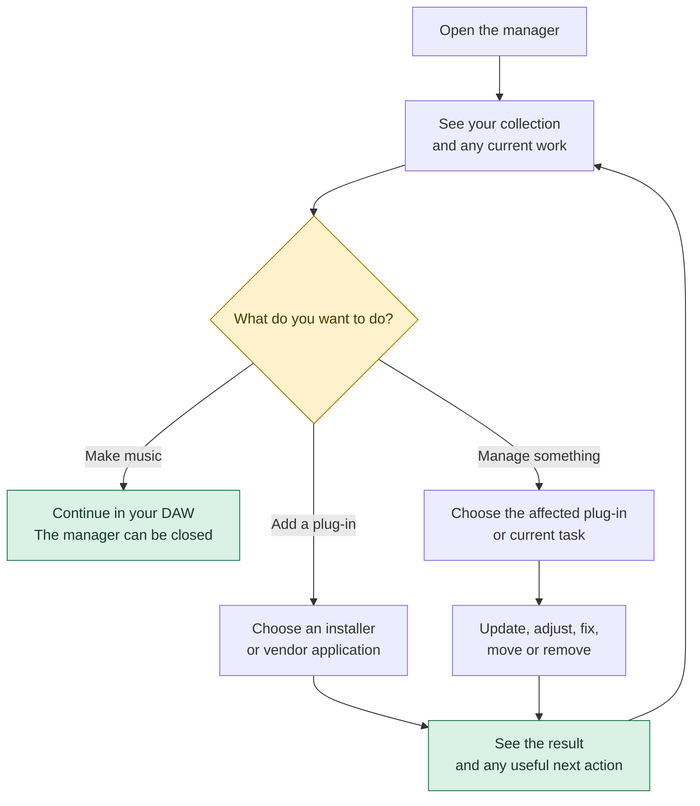
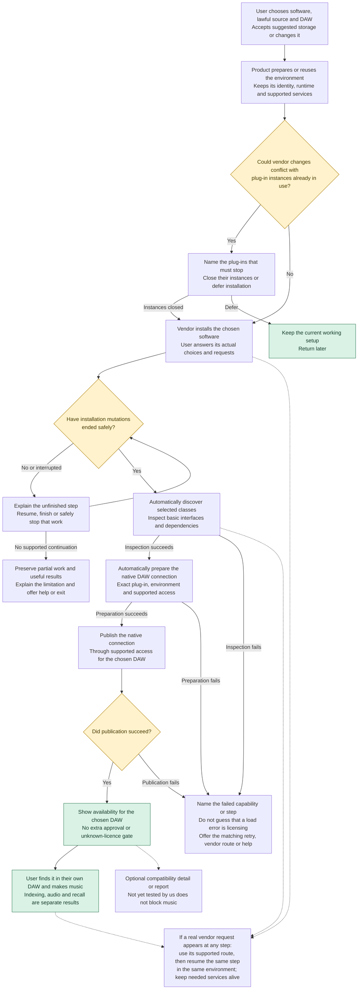
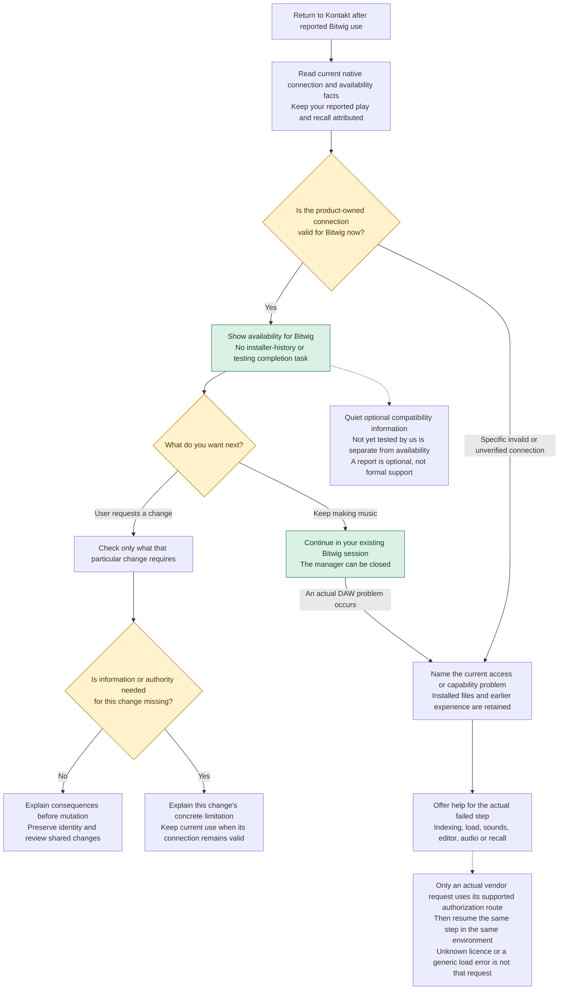
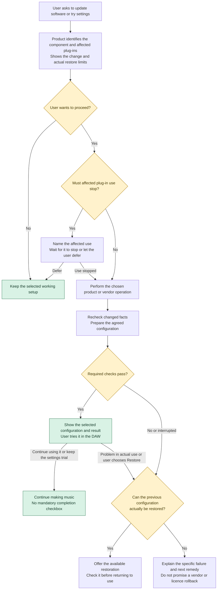
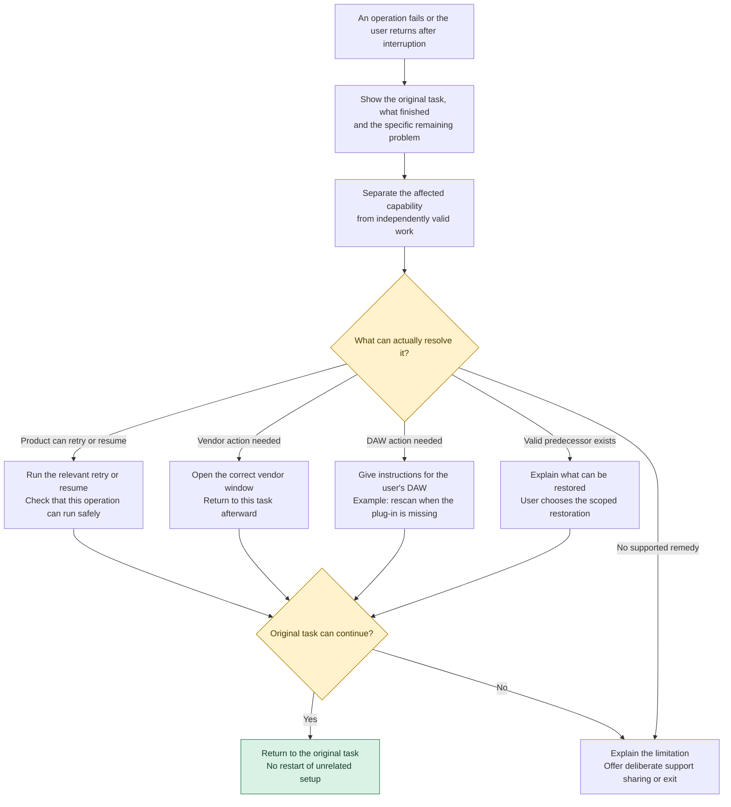
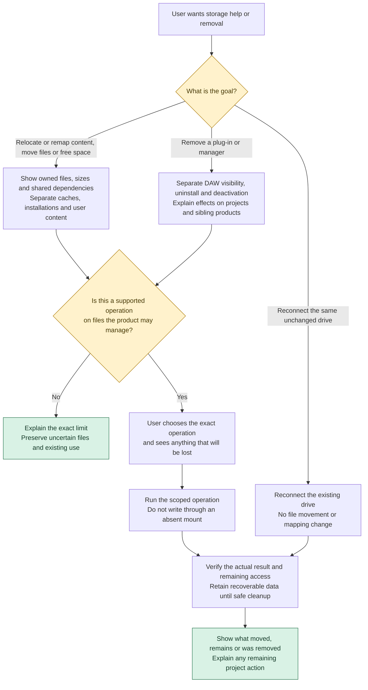
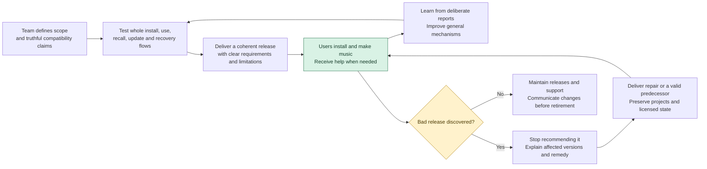

# Product flow walkthrough

Read the diagrams in order, starting with ordinary use and adding a plug-in.
The [interactive viewer](index.html) provides readable-size and fit controls.
The [full product model](../01-product-and-user-experience.md) contains the task
inventory and detailed boundaries. These are design flows, not installed claims.

The [replacement clickable prototype](../prototype/index.html) follows one musician
adding eFX FRAGMENTS to Bitwig through Arturia Software Center. The operator
rejected the earlier layout comparison because specification terms became confusing
actions with no concrete user reason. The new question is whether each step and
button makes sense without narration. It includes downloaded-installer choice,
suggested storage with an optional drive change, a separate vendor-window stand-in,
automatic readiness and one unfinished download/resume. The user accepted this
first-install interaction, including the suggested device-neutral storage.
The next [returning journey](../prototype/index.html?journey=returning) adds Analog
Lab V through the already installed ASC. It retains the installation and location,
names FRAGMENTS before shared installation work, and offers postponement while its
Bitwig project is open. The project-close event is outside the product; stopping
playback is not enough. Completed first installation naturally reaches the same
ASC entry. The user also accepted this returning interaction. The
[working Kontakt mock](../prototype/index.html?journey=kontakt) is illustrative but
insufficient: it assumes a valid connection rather than explaining the original
conflation of experimental publication, testing, installer history and availability.
The user's Bitwig play/save/reopen report remains attributed. Missing history alone
is not the explicit partial-installation condition behind the special old warning;
the exact installed cause remains unverified. The [responsibility table and sequence](../01-product-and-user-experience.md#responsibilities-and-normal-sequence)
now separate the work and its observable results. Manager implementation stays paused.
The broader flows and five selected policies still apply, including update recovery.
All activity is in-memory simulation. **Save offline copy** downloads the complete
prototype with the chosen starting journey; reload starts that fixture over. The
outside-product selector and `?journey=first/returning/kontakt` choose the starting situation.
The optional server command below serves it at
`/prototype/`; direct file viewing needs no server.

## The five agreed choices

- **First installation:** chosen plug-ins become available automatically after
  vendor steps and required checks. Changing a working setup gets its own review.
- **Existing collections:** beta manages this product’s installations and coexists
  with external Wine/yabridge setups. Migration is later work.
- **Storage:** beta includes drive choice, missing-library reconnection and
  supported same-machine moves. Full collection backup and computer transfer come
  later. Recovery from product updates remains required.
- **Completion:** normal status uses observed facts. User feedback is optional in
  help/testing; ordinary use never requires “mark installed”.
- **Support:** testers use their existing private contact with the maintainer.
  Diagnostics are exported and shared only by deliberate user choice. An in-app
  support submission service is not required for beta.

The policies are selected; the flow details still need walkthrough and usability
validation. Boxes describe work, not a list of screens. Diamonds include automatic
product decisions and do not imply prompts for the user.

Green marks an outcome; yellow marks a decision or condition. Labels carry the
same meaning without color. Each Mermaid file is editable; the matching diagram
below renders on GitHub.

## Start with three concrete situations

These are proposed interactions for discussion, not observed test results or
final screen copy. The diagrams include automatic product work as well as actions
the person takes.

| Situation | What the person does | What the product handles | When the task is finished |
| --- | --- | --- | --- |
| A new REAPER user wants a plug-in | Install the manager, choose the installer or vendor application, make needed drive/DAW choices, and complete vendor steps | Acquire its runtime, supervise installation, discover and prepare the selected plug-ins, and make them available; explain a real failure if one occurs | The user can find the plug-in in REAPER and make music. Rescan guidance appears only when needed. No separate prepare/publish lesson or completion checkbox. |
| An ASC user wants another Arturia product | Open the existing managed ASC context, choose the additional product and complete vendor choices | Show affected plug-ins before maintenance; preserve the existing identity; finish the safe handoff from vendor maintenance; automatically prepare the selected new products | The new product is available and existing products have a clear result. If affected plug-ins are in use, the user can defer maintenance and keep making music. |
| Kontakt already plays and recalls in Bitwig, as reported by the user | Continue in Bitwig; inspect optional information or request a concrete change only when wanted | Establish current availability independently of installer history and compatibility evidence; retain the attributed experience and unknown history | A valid native connection has no completion chore or mandatory test in another DAW. Actual use failures and a requested change receive their own concrete actions. |

The next design exercise is to walk these situations through proposed navigation
and actions. A flow is successful when the person can explain their situation,
choose the next action and recognize completion without the designer narrating it.

## An ordinary visit

Start with the collection and the user’s goal. A working user can go straight back to the DAW. This does not prescribe a screen layout.

[Editable Mermaid source](start.mmd)



## Add a plug-in

The user handles vendor choices; the product automatically discovers, inspects and
connects selected plug-ins to the chosen DAW. Installation mutations must end safely;
a closed window is insufficient and needed licensing services may remain alive.
Dashed boxes describe cross-cutting handoffs and optional evidence, not extra gates.
Authorization may occur before, during, at first use or later; an actual request
returns to the same step and environment. Unknown licence state is not failure.
Publication does not prove DAW indexing, audio correctness or recall.

[Editable Mermaid source](install.mmd)



## Kontakt already works

Current availability, the user's Bitwig experience, compatibility evidence and
history are different facts. “Not yet tested by us” can be a quiet optional detail;
it does not require a REAPER test or success report. Missing history matters only
when a requested operation needs it; a report cannot manufacture current authority.
An actual DAW failure does not erase the installation and needs its specific fix.
The diagram specifies desired behavior, not the exact installed manager's cause.

[Editable Mermaid source](working.mmd)



## Update or change settings

Explain shared effects and the actual restoration limits before a change. Retain a route back when preparation passes but actual DAW use fails. A trial can be kept or restored; ordinary use needs no completion checkbox.

[Editable Mermaid source](change.mmd)



## Recover a problem

Preserve the original task and independently valid work. A specific failure gets a relevant retry, external handoff, supported restoration or help/exit route.

[Editable Mermaid source](recover.mmd)



## Move, reconnect or remove

Reconnecting the same unchanged drive is distinct from moving or remapping content. Every mutation follows ownership, capability, destination and consequence checks. Unsupported relocation or licensed migration remains a named gap, not a promised operation.

[Editable Mermaid source](storage.mmd)



## Deliver and support the product

These are our responsibilities, not extra work for the musician. A release, support promise or restoration offer needs a corresponding operation behind it.

[Editable Mermaid source](product-lifetime.mmd)



## Open the standalone viewer

Open [index.html](index.html) directly in a browser, including from the file
browser. It embeds all seven SVG diagrams and their Mermaid text. Viewing and
switching flows need no server, renderer download or internet connection.
**Save offline copy** downloads one HTML file with the current flow and viewing
preferences. **Editable Mermaid source** downloads the selected flow's `.mmd`
text from the embedded copy.

An optional local HTTP address is also available. From the repository root, run:

```sh
python3 -m http.server 8769 --bind 127.0.0.1 --directory docs/design-dossier
```

Then open <http://127.0.0.1:8769/flows/>. Save an offline copy before closing the
server if you want to keep using the downloaded file later.

## Regenerate after editing a diagram

The `.mmd` files are the source of truth. Keep their matching Mermaid blocks in
this walkthrough aligned when editing them, then run:

```sh
python3 docs/design-dossier/flows/regenerate.py
```

Open the temporary localhost URL printed by the command in a browser. This
renders all seven sources with Mermaid **11.12.0** and the viewer's existing theme,
then replaces only the embedded source/SVG block in `index.html`. The command
stops its temporary server when done. Regeneration needs an internet connection
for the pinned renderer; the resulting viewer does not. Python and a browser are
enough, with no installed Node packages or permanent service. A failed render
leaves the existing viewer intact; Ctrl-C cancels the temporary server.
