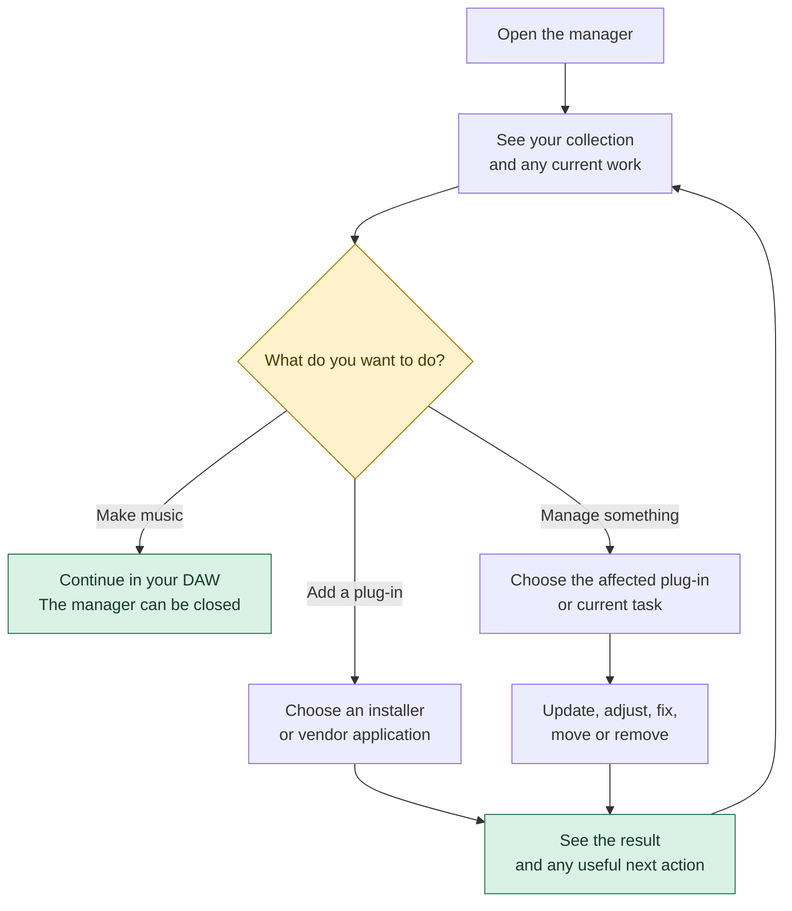
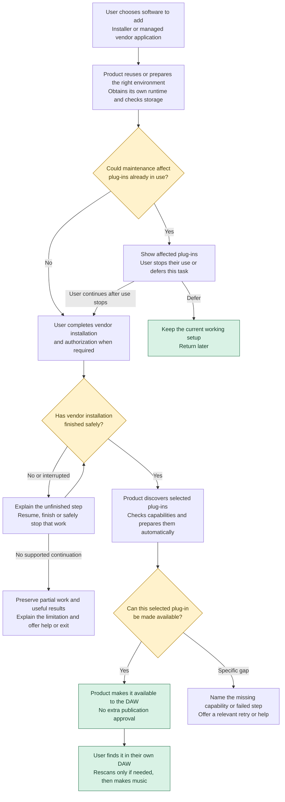
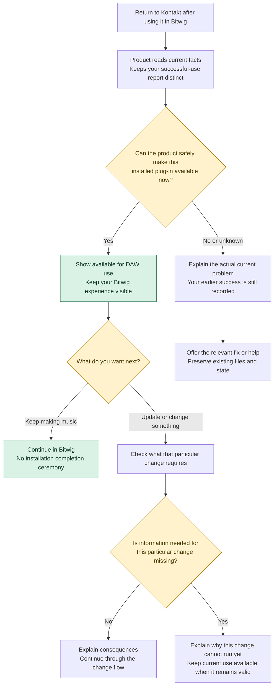
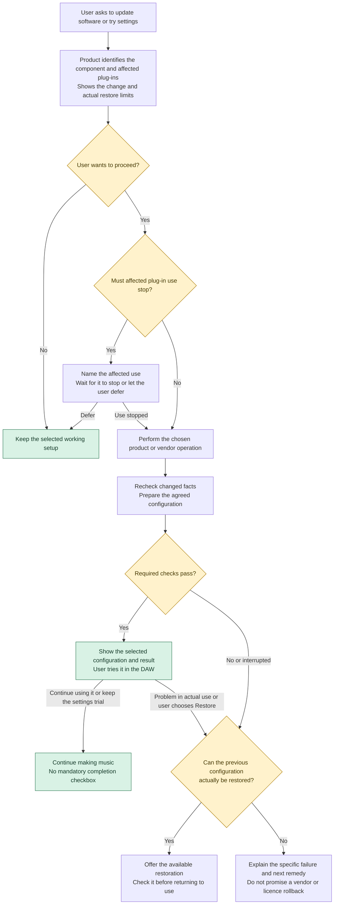
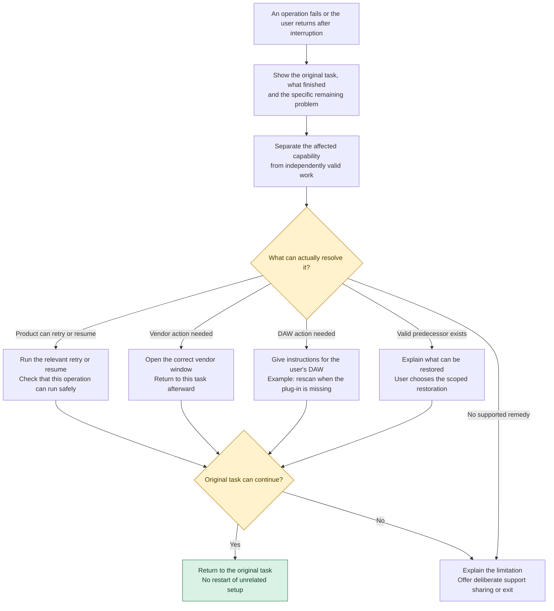
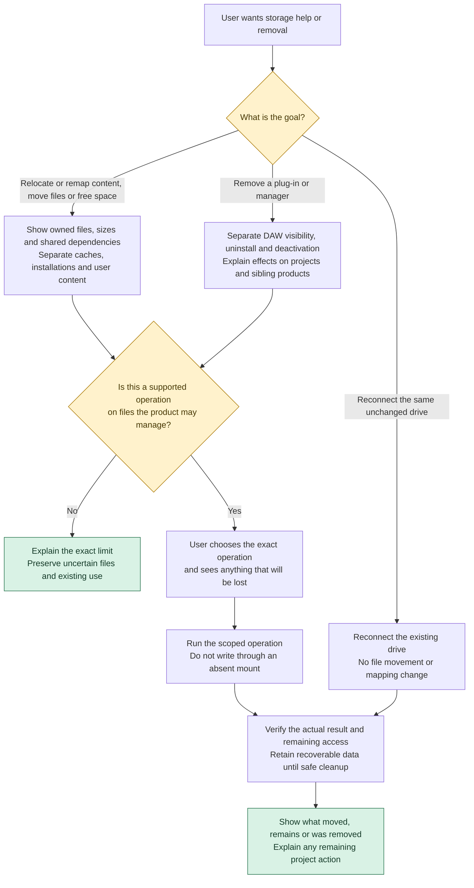
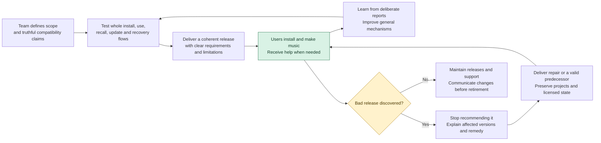

# Product flow walkthrough

Read the diagrams in order, starting with ordinary use and adding a plug-in.
The [interactive viewer](index.html) provides readable-size and fit controls.
The [full product model](../01-product-and-user-experience.md) contains the task
inventory and detailed boundaries. These are design flows, not installed claims.

## The five agreed choices

- **First installation:** chosen plug-ins become available automatically after
  vendor steps and required checks. Changing a working setup gets its own review.
- **Existing collections:** beta manages this product’s installations and coexists
  with external Wine/yabridge setups. Migration is later work.
- **Storage:** beta includes drive choice, missing-library reconnection and
  supported same-machine moves. Full collection backup and computer transfer come
  later. Recovery from product updates remains required.
- **Completion:** normal status uses observed facts. User feedback is optional in
  help/testing; ordinary use never requires “mark installed”.
- **Support:** testers use their existing private contact with the maintainer.
  Diagnostics are exported and shared only by deliberate user choice. An in-app
  support submission service is not required for beta.

The policies are selected; the flow details still need walkthrough and usability
validation. Boxes describe work, not a list of screens. Diamonds include automatic
product decisions and do not imply prompts for the user.

Green marks an outcome; yellow marks a decision or condition. Labels carry the
same meaning without color. Each Mermaid file is editable; the matching diagram
below renders on GitHub.

## Start with three concrete situations

These are proposed interactions for discussion, not observed test results or
final screen copy. The diagrams include automatic product work as well as actions
the person takes.

| Situation | What the person does | What the product handles | When the task is finished |
| --- | --- | --- | --- |
| A new REAPER user wants a plug-in | Install the manager, choose the installer or vendor application, make needed drive/DAW choices, and complete vendor steps | Acquire its runtime, supervise installation, discover and prepare the selected plug-ins, and make them available; explain a real failure if one occurs | The user can find the plug-in in REAPER and make music. Rescan guidance appears only when needed. No separate prepare/publish lesson or completion checkbox. |
| An ASC user wants another Arturia product | Open the existing managed ASC context, choose the additional product and complete vendor choices | Show affected plug-ins before maintenance; preserve the existing identity; finish the safe handoff from vendor maintenance; automatically prepare the selected new products | The new product is available and existing products have a clear result. If affected plug-ins are in use, the user can defer maintenance and keep making music. |
| Kontakt already works and recalls in Bitwig | Return to the manager, inspect Kontakt if wanted, then continue in Bitwig | For this scenario, the current route is valid and only an old installer result is missing. Show current availability and the attributed use report; retain history without turning it into unrelated setup work | Nothing needs confirming to continue use. If the user later requests a change that needs missing history, explain that particular limitation and a valid recovery path. |

The next design exercise is to walk these situations through proposed navigation
and actions. A flow is successful when the person can explain their situation,
choose the next action and recognize completion without the designer narrating it.

## An ordinary visit

Start with the collection and the user’s goal. A working user can go straight back to the DAW. This does not prescribe a screen layout.

[Editable Mermaid source](start.mmd)



## Add a plug-in

The user handles vendor choices. The product supplies compatibility work and automatically makes selected plug-ins available after vendor steps and required checks. A closed vendor window alone is not proof that maintenance has safely ended.

[Editable Mermaid source](install.mmd)



## Kontakt already works

Current availability, the user’s Bitwig experience and the authority needed for a future update are different facts. Missing old installer history creates a task only when it has a concrete consequence; a user report cannot manufacture missing current authority.

[Editable Mermaid source](working.mmd)



## Update or change settings

Explain shared effects and the actual restoration limits before a change. Retain a route back when preparation passes but actual DAW use fails. A trial can be kept or restored; ordinary use needs no completion checkbox.

[Editable Mermaid source](change.mmd)



## Recover a problem

Preserve the original task and independently valid work. A specific failure gets a relevant retry, external handoff, supported restoration or help/exit route.

[Editable Mermaid source](recover.mmd)



## Move, reconnect or remove

Reconnecting the same unchanged drive is distinct from moving or remapping content. Every mutation follows ownership, capability, destination and consequence checks. Unsupported relocation or licensed migration remains a named gap, not a promised operation.

[Editable Mermaid source](storage.mmd)



## Deliver and support the product

These are our responsibilities, not extra work for the musician. A release, support promise or restoration offer needs a corresponding operation behind it.

[Editable Mermaid source](product-lifetime.mmd)



## Open the interactive viewer locally

From the repository root, run:

```sh
python3 -m http.server 8769 --bind 127.0.0.1 --directory docs/design-dossier
```

Then open <http://127.0.0.1:8769/flows/>. The viewer loads a pinned Mermaid
renderer from a CDN. The Markdown and Mermaid sources remain usable independently.
When editing a Mermaid source, keep its matching block in this walkthrough aligned.
